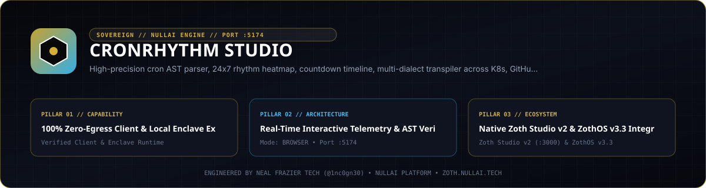

<p align="center">
  
</p>

# CronRhythm Studio (`v2.6.0`)

**Zero-dependency Python 3.9+ stdlib & in-browser POSIX/Quartz cron AST parser, natural-language humanizer, interactive 24x7 weekly rhythm heatmap, multi-job thundering-herd optimizer, Daylight Saving Time (DST) anomaly auditor, cross-dialect transpiler, Unicode Braille TUI, and 12-tool MCP server.**

- **Zoth Studio v2 Dossier**: [https://zoth.nullai.tech/tools/cron-rhythm-studio](https://zoth.nullai.tech/tools/cron-rhythm-studio)
- **Default Loopback Endpoint**: `http://127.0.0.1:5174` (on-demand loopback daemon)
- **Runtime Dependencies**: Zero external Python runtime packages (100% Python `stdlib`) and zero external CDN/font egress
- **License**: MIT (100% free and open-access)

---

## Overview

`cron-rhythm-studio` parses 5-, 6-, and 7-field UNIX/Quartz crontabs, named days/months (`MON-FRI`, `JAN-DEC`, Sunday `7 -> 0`), and macros (`@hourly`, `@daily`, `@midnight`, `@weekly`, `@monthly`, `@yearly`, `@annually`, `@reboot`) into a validated schedule AST. It computes DST-safe upcoming execution timestamps (skipping non-existent spring-forward gap times and handling leap-year `0 0 29 2 *` cleanly), renders interactive 168-hour (24x7) trigger density heatmaps, audits fleets for concurrent thundering-herd collisions and DST anomalies, and transpiles schedules to `systemd` `OnCalendar` (with explicit POSIX `OR` → `systemd` `AND` semantic warnings), Kubernetes `CronJob`, GitHub Actions, AWS EventBridge, and Quartz Scheduler formats.

---

## Architecture

```text
src/cron_rhythm_studio/
├── __init__.py            # Public package exports & unified v2.6.0 version
├── models.py              # Typed dataclasses for AST, NextRunItem, RhythmMatrix, Fleet, Transpile
├── parser.py              # 5/6/7-field & @macro cron lexer, bounds validator, and AST builder
├── timeline_engine.py     # DST-aware next/prev run calculator, jitter & schedule diff engine
├── rhythm_matrix.py       # 24x7 weekly workload density matrix & ASCII renderer
├── humanizer.py           # Token-level natural-language English schedule translator
├── transpiler.py          # Cross-dialect emitter (UNIX, Quartz, AWS EventBridge, systemd, GitHub Actions, K8s)
├── fleet_optimizer.py     # Multi-job concurrency collision detector & jitter rebalancer
├── timezone_auditor.py    # IANA DST spring-forward/fall-back anomaly auditor & world flight board
├── catalog.py             # 40+ curated production schedule presets
├── compat.py              # Cross-platform host diagnostics & safe filesystem helpers
├── mcp_server.py          # JSON-RPC 2.0 stdio MCP server exposing 12 schedule engineering tools
└── cli.py                 # Unified CLI entrypoint & hardened loopback HTTP/REST server (127.0.0.1:5174)

public/
├── index.html             # Dual-theme (Editorial Ivory Light / Obsidian Dark) zero-egress workstation
├── cron-engine.js         # Verified pure-JS POSIX/Quartz engine with offline DST/Fleet/TZ fallbacks
└── sovereign_tutorial.js  # Safe-DOM dual-theme quickstart guide

bin/
├── cron-rhythm-studio     # Portable CLI wrapper (dynamically resolves /opt/cron-rhythm-studio or checkout)
└── cron-rhythm-studio-tui # Unicode U+2800 Braille 24x7 Cron Rhythm TUI
```

---

## Quickstart

```bash
git clone https://github.com/1nc0gn30/cron-rhythm-studio.git
cd cron-rhythm-studio
python3 -m pytest -q

# Launch the hardened loopback web workstation on http://127.0.0.1:5174
python3 server.py --host 127.0.0.1 --port 5174
```

Run directly via package module:

```bash
PYTHONPATH=src python3 -m cron_rhythm_studio.cli serve --host 127.0.0.1 --port 5174
```

---

## CLI, Braille TUI & MCP Usage

### CLI & Braille TUI Commands

Installed entrypoints: `cron-rhythm-studio`, `cron-rhythm` (symlink), and `cron-rhythm-studio-tui`.

```bash
# View CLI help & portable JSON status
cron-rhythm-studio --help
cron-rhythm-studio --status --json

# Parse a cron expression into structured AST JSON
cron-rhythm parse "*/15 9-17 * * MON-FRI" --json

# Translate a cron schedule into plain English
cron-rhythm humanize "0 0 13 * 5"

# Project the next 10 execution timestamps (DST-safe)
cron-rhythm next "*/15 * * * *" -n 10 --json
cron-rhythm next "30 2 * * *" -tz America/New_York -n 5 --json

# Transpile into Systemd OnCalendar, Kubernetes CronJob, EventBridge, GitHub Actions, or Quartz
cron-rhythm transpile "30 4 * * 1-5" --target systemd
cron-rhythm transpile "0 */6 * * *" --target kubernetes

# Render the 24x7 weekly trigger density matrix
cron-rhythm rhythm "*/10 8-20 * * 1-5" --json

# Audit Daylight Saving Time clock-shift skip/duplicate anomalies
cron-rhythm dst-audit "30 2 * * *" --timezone America/New_York --year 2026 --json

# Synchronize next trigger times across global engineering hubs
cron-rhythm tz-board "0 14 * * 1-5" --json

# Audit a multi-job fleet for concurrent thundering-herd spikes
cron-rhythm fleet --demo --json

# List 40+ curated cron presets
cron-rhythm presets --json

# Launch the Unicode U+2800 Braille Cron Rhythm TUI
cron-rhythm-studio-tui --expr "30 4 * * 1-5" --tz America/New_York --once
cron-rhythm-studio-tui --expr "*/15 * * * *" --json

# Run the stdio MCP server
cron-rhythm-studio mcp
```

### Model Context Protocol (MCP) — 12 Tools

```json
{
  "mcpServers": {
    "cron-rhythm-studio": {
      "command": "cron-rhythm-studio",
      "args": ["mcp"]
    }
  }
}
```

| MCP Tool | Description |
| :--- | :--- |
| `cron_parse_expression` | Parse and validate a cron string into per-field AST sets |
| `cron_next_runs` | Compute upcoming DST-safe ISO-8601 execution timestamps |
| `cron_calculate_timeline` | Compute upcoming/previous timeline with jitter options |
| `cron_humanize` | Translate cron syntax into human-readable English |
| `cron_transpile` | Convert cron syntax to UNIX, Quartz, AWS EventBridge, `systemd`, GitHub Actions, or Kubernetes |
| `cron_rhythm_matrix` | Compute the 7x24 weekly execution density matrix |
| `cron_audit_fleet` | Detect multi-job concurrency collisions and rebalance schedules |
| `cron_audit_dst_anomalies` | Audit spring-forward skipped runs and fall-back duplicate runs in IANA zones |
| `cron_multizone_flight_board` | Project next executions across global timezones simultaneously |
| `cron_list_presets` | Query curated schedule presets by category or keyword |
| `cron_preset_catalog` | Return full categorized preset catalog metadata |
| `cron_diagnostics` | Inspect host OS, Python runtime, and timezone database availability |

---

## Hardened Loopback HTTP API (`127.0.0.1:5174`)

Enforces strict loopback `Host` allowlist (`403` JSON on DNS-rebinding), exact-port `Origin` CORS allowlist (`:5174` / `:3000`, blocking `:51740`), all 4 security headers (`X-Frame-Options`, `X-Content-Type-Options`, `Referrer-Policy`, zero-egress `Content-Security-Policy`), canonical path-traversal blocking (`403` JSON), `1 MiB` `POST` body cap (`413` JSON), and strict JSON/query validation (`400` JSON).

| Method | Endpoint | Description |
| :--- | :--- | :--- |
| `GET` / `HEAD` | `/health`, `/api/health` | Service health status and `v2.6.0` JSON |
| `GET` | `/api/diagnostics` | Host platform and timezone runtime telemetry |
| `GET` | `/api/parse?expr=...` | Parse cron expression into AST JSON |
| `GET` | `/api/humanize?expr=...` | Return English description and field breakdown |
| `GET` | `/api/next?expr=...&count=10&tz=UTC` | Project upcoming DST-safe execution datetimes |
| `GET` | `/api/transpile?expr=...&target=systemd` | Transpile cron schedule to target scheduler dialect |
| `GET` | `/api/rhythm?expr=...` | Compute 24x7 hourly trigger heatmap matrix |
| `GET` | `/api/presets` | List 40+ schedule templates |
| `GET` / `POST` | `/api/fleet` | Fleet concurrency audit and jitter optimization |
| `GET` / `POST` | `/api/dst-audit` | Daylight Saving Time anomaly analysis |
| `GET` / `POST` | `/api/tz-board` | Multi-timezone synchronized execution board |
| `GET` | `/api/mcp/config` | Return stdio MCP config JSON and all 12 registered tools |
| `GET` / `POST` | `/api/export-bundle` | Generate `.timer`, `.service`, `.crontab`, and all dialect configs |

---

## Testing & Verification

```bash
# Run Python pytest suite (engine, DST, security, CLI/TUI)
python3 -m pytest -q

# Run Node client-side cron engine verification
node --test tests/test_cron_engine.mjs

# Run internal CLI self-test
cron-rhythm-studio test
```

---

## Support

CronRhythm Studio is 100% free and open-access software with zero paywalls or feature gates. Optional community support is available via [☕ Buy Us a Coffee (Stripe)](https://buy.stripe.com/3cIfZg27PdKo2D64Ocfw40X) or Solana Tip (`GG2eQbVh8ut1BK6j1A2tz7pSySdLpD38BgyEhGcxdXoK`).

## License

MIT License — Engineered by Neal Frazier Tech ([`@1nc0gn30`](https://github.com/1nc0gn30)) • [NullAI Platform](https://nullai.tech). See [LICENSE](LICENSE) for full text.
