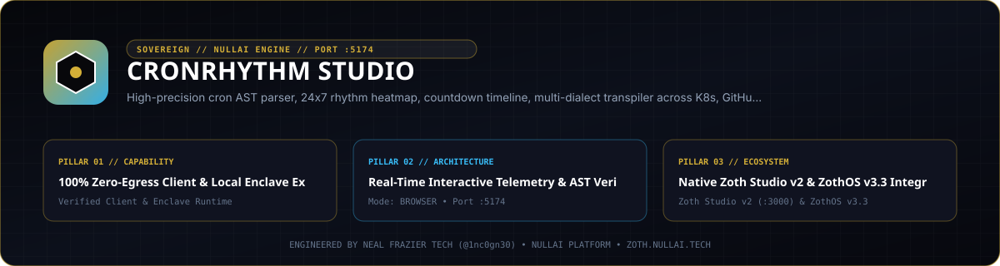

<p align="center">
  
</p>

# Cron Rhythm Studio

**Zero-dependency Python 3.9+ cron expression AST parser, natural-language humanizer, 24x7 weekly workload rhythm matrix, multi-job thundering-herd optimizer, Daylight Saving Time (DST) anomaly auditor, cross-dialect transpiler, and MCP server.**

- **Zoth Studio v2 Dossier**: [https://zoth.nullai.tech/tools/cron-rhythm-studio](https://zoth.nullai.tech/tools/cron-rhythm-studio)
- **Default Loopback Endpoint**: `http://127.0.0.1:5174`
- **Runtime Dependencies**: Zero external Python runtime packages (100% Python `stdlib`)
- **License**: MIT (100% free and open-source)

---

## Overview

`cron-rhythm-studio` parses standard 5-field UNIX crontabs and extended macros (`@hourly`, `@daily`, `@weekly`, `@monthly`, `@yearly`) into a structured schedule AST, translates schedules into plain English, computes upcoming execution timestamps across IANA timezones, visualizes 168-hour (24x7) trigger density matrices, audits fleet schedules for concurrent thundering-herd collisions and DST spring-forward/fall-back anomalies, and transpiles schedules to Kubernetes `CronJob`, GitHub Actions, AWS EventBridge, `systemd` `OnCalendar`, and 6-field Quartz Scheduler expressions.

---

## Architecture

```text
src/cron_rhythm_studio/
├── parser.py              # 5-field & macro cron lexer, validator, and AST builder
├── scheduler.py           # Deterministic next-run iterator & 24x7 hourly rhythm matrix calculator
├── humanizer.py           # Token-level natural-language English schedule translator
├── transpiler.py          # Cross-dialect emitter (Kubernetes, GitHub Actions, AWS EventBridge, systemd, Quartz)
├── fleet_optimizer.py     # Multi-job concurrency collision detector & jitter desynchronizer
├── dst_auditor.py         # IANA timezone DST skipped/duplicate execution risk analyzer & world tz board
├── catalog.py             # Production schedule preset catalog
├── mcp_server.py          # JSON-RPC 2.0 stdio MCP server exposing 12 schedule engineering tools
└── cli.py                 # Unified CLI entrypoint & HTTP REST/UI server (127.0.0.1:5174)
```

---

## Quickstart

```bash
git clone https://github.com/1nc0gn30/cron-rhythm-studio.git
cd cron-rhythm-studio
python3 -m pip install -e ".[dev]"

# Launch the loopback web workstation on http://127.0.0.1:5174
cron-rhythm-studio serve --host 127.0.0.1 --port 5174
```

Run directly from a source checkout without installing:

```bash
PYTHONPATH=src python3 -m cron_rhythm_studio.cli serve --port 5174
```

---

## CLI & MCP Usage

### CLI Subcommands

Installed entrypoints: `cron-rhythm`, `cron-rhythm-studio`, and `cronrhythm`.

```bash
# View CLI help
cron-rhythm --help

# Parse a cron expression into structured AST JSON
cron-rhythm parse "*/15 9-17 * * 1-5" --json

# Translate a cron schedule into plain English
cron-rhythm humanize "0 2 * * 0"

# Project the next 10 execution timestamps
cron-rhythm next "30 4 1,15 * *" -n 10 --json

# Transpile into Kubernetes CronJob, systemd OnCalendar, EventBridge, GitHub Actions, or Quartz
cron-rhythm transpile "0 */6 * * *" --target kubernetes
cron-rhythm transpile "0 3 * * 1-5" --target systemd

# Render the 24x7 weekly trigger density matrix
cron-rhythm rhythm "*/10 8-20 * * 1-5" --json

# Audit Daylight Saving Time clock-shift skip/duplicate anomalies
cron-rhythm dst-audit "30 2 * * *" --tz America/New_York --json

# Synchronize next trigger times across global engineering hubs
cron-rhythm tz-board "0 14 * * 1-5" --json

# Audit a multi-job fleet for concurrent thundering-herd spikes
cron-rhythm fleet "0 * * * *" "0 */2 * * *" "0 0 * * *" --json

# List curated cron presets
cron-rhythm presets --json

# Run the stdio MCP server
cron-rhythm mcp
```

### ZothOS v3.4.0 CLI Integration

On ZothOS v3.4.0 workstations, `cron-rhythm` is symlinked in `/usr/local/bin/cron-rhythm`:

```bash
cron-rhythm humanize "*/5 * * * *"
cron-rhythm web              # Starts http://127.0.0.1:5174
cron-rhythm desktop          # Launches the Electron workstation shell
```

### Model Context Protocol (MCP) Tools

```json
{
  "mcpServers": {
    "cron-rhythm-studio": {
      "command": "cron-rhythm-studio",
      "args": ["mcp"]
    }
  }
}
```

| MCP Tool | Description |
| :--- | :--- |
| `cron_parse_expression` | Parse and validate a cron string into per-field AST sets |
| `cron_next_runs` / `cron_calculate_timeline` | Compute upcoming ISO-8601 execution timestamps |
| `cron_humanize` | Translate cron syntax into human-readable English |
| `cron_transpile` | Convert cron syntax to Kubernetes, GitHub Actions, AWS EventBridge, `systemd`, or Quartz |
| `cron_rhythm_matrix` | Compute the 7x24 weekly execution density matrix |
| `cron_audit_fleet` | Detect multi-job concurrency collisions and suggest desynchronized schedules |
| `cron_audit_dst_anomalies` | Audit spring-forward skipped runs and fall-back duplicate runs in IANA zones |
| `cron_multizone_flight_board` | Project next execution across global timezones simultaneously |
| `cron_list_presets` / `cron_preset_catalog` | Query curated schedule presets by category or keyword |
| `cron_diagnostics` | Inspect host OS, Python runtime, and timezone database availability |

---

## HTTP API Reference

When running on `http://127.0.0.1:5174`:

| Method | Endpoint | Description |
| :--- | :--- | :--- |
| `GET` | `/health`, `/api/health` | Service health status and version JSON |
| `GET` | `/api/parse?expr=...` | Parse cron expression into AST JSON |
| `GET` | `/api/humanize?expr=...` | Return English description and field breakdown |
| `GET` | `/api/next?expr=...&count=10` | Project upcoming execution datetimes |
| `GET` | `/api/transpile?expr=...&target=...` | Transpile cron schedule to target scheduler dialect |
| `GET` | `/api/rhythm?expr=...` | Compute 24x7 hourly trigger heatmap matrix |
| `GET` | `/api/presets` | List schedule templates |
| `GET` / `POST` | `/api/fleet` | Fleet concurrency audit and jitter optimization |
| `GET` / `POST` | `/api/dst-audit` | Daylight Saving Time anomaly analysis |
| `GET` / `POST` | `/api/tz-board` | Multi-timezone synchronized execution board |

---

## Testing & Verification

```bash
# Run the pytest test suite
python3 -m pytest -q

# Run internal CLI self-test
cron-rhythm-studio test

# Scan repository with gitleaks
gitleaks detect --source . --no-banner --redact
```

---

## Support

Cron Rhythm Studio is 100% free and open-source software. Optional community support is available via [Buy Us a Coffee (Stripe)](https://buy.stripe.com/3cIfZg27PdKo2D64Ocfw40X).

## License

MIT License — Copyright (c) 2026 [1nc0gn30](https://1nc0gn30.si) (`@1nc0gn30`) & [NullAI](https://nullai.tech). See [LICENSE](LICENSE) for full text.
